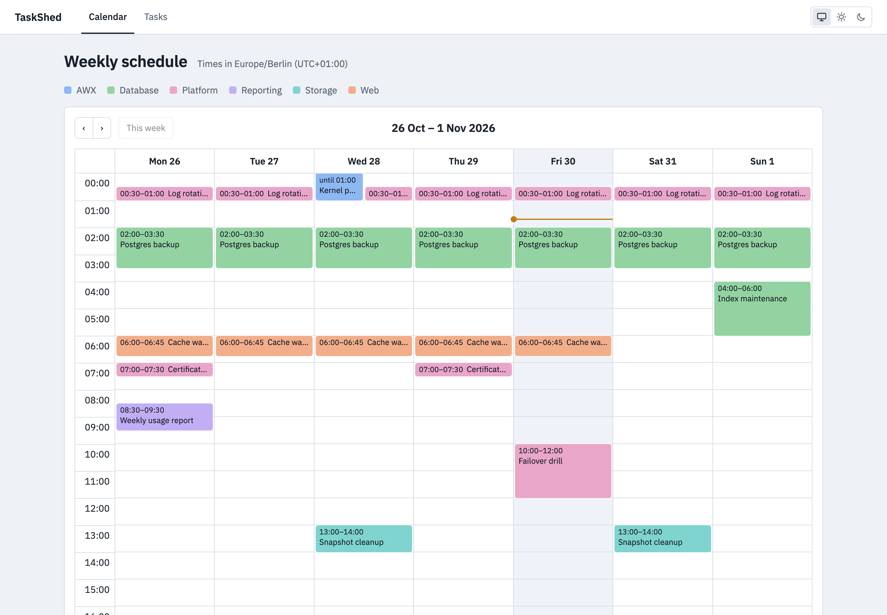
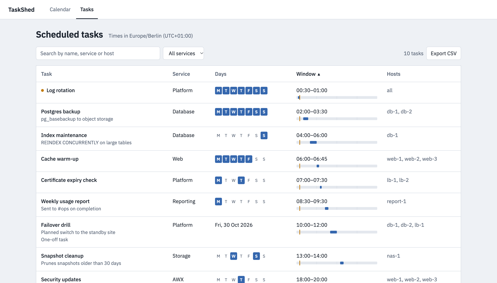
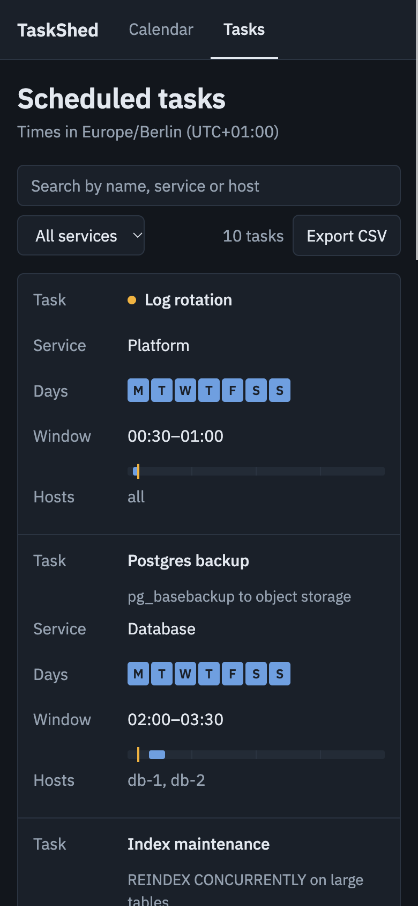

# TaskShed

A single place to see when scheduled jobs run across your systems.

[](https://github.com/neverlless/taskshed/actions/workflows/ci.yml)
[](https://github.com/neverlless/taskshed/releases/latest)
[](go.mod)
[](https://github.com/neverlless/taskshed/pkgs/container/taskshed)
[](LICENSE)

TaskShed is a small web app and REST API for recording scheduled tasks (backups, cron jobs, maintenance windows) and seeing them on one weekly calendar. Your automation registers tasks through the API and the UI shows them read-only; TaskShed does not run them. It ships as a single static binary with the UI embedded, and stores data in SQLite or PostgreSQL.

## Screenshots

<picture>
  <source media="(prefers-color-scheme: dark)" srcset="docs/screenshots/calendar-dark.png">
  <source media="(prefers-color-scheme: light)" srcset="docs/screenshots/calendar-light.png">
  
</picture>

<picture>
  <source media="(prefers-color-scheme: dark)" srcset="docs/screenshots/tasks-dark.png">
  <source media="(prefers-color-scheme: light)" srcset="docs/screenshots/tasks-light.png">
  
</picture>



## Contents

- [Features](#features)
- [Quick start](#quick-start)
- [Configuration](#configuration)
- [API](#api)
- [Deployment](#deployment)
- [Upgrading](#upgrading)
- [Development](#development)
- [Project layout](#project-layout)
- [License](#license)

## Features

- Weekly calendar of recurring and one-off tasks.
- Task table with a 24-hour window strip per task and a marker on tasks running now.
- Server-rendered UI with htmx: no build step and little JavaScript.
- Times are converted to the viewer's timezone on the server and stay correct across DST changes.
- Search, service filter and sort are kept in the URL, so a filtered view can be bookmarked or shared.
- CSV export of the filtered task list, in the viewer's timezone.
- Read-only UI; tasks are created and changed through the API.
- SQLite (default, zero setup) or PostgreSQL storage.
- Single static binary with the web UI embedded; no runtime files needed.
- Optional bearer token for write requests; reads stay open.
- `/healthz` endpoint and a built-in `-healthcheck` command for container probes.
- JSON logs on stdout, graceful shutdown on SIGTERM, automatic schema migrations.

## Quick start

### Binary

Download an archive for your platform from the [releases page](https://github.com/neverlless/taskshed/releases/latest), then:

```sh
tar -xzf taskshed_*_linux_amd64.tar.gz
./taskshed
```

Open http://localhost:8080. Data is stored in `./taskshed.db`.

### Docker

```sh
docker run -d --name taskshed \
  -p 8080:8080 \
  -v taskshed-data:/data \
  -e API_TOKEN=change-me \
  ghcr.io/neverlless/taskshed:latest
```

The image runs as a non-root user and keeps the SQLite database in the `/data` volume.

### Docker Compose

The repository's [`docker-compose.yml`](docker-compose.yml) runs TaskShed on SQLite by default, with an optional PostgreSQL service:

```sh
# SQLite
API_TOKEN=change-me docker compose up -d

# PostgreSQL
API_TOKEN=change-me DB_TYPE=postgres POSTGRES_PASSWORD=change-me \
  docker compose --profile postgres up -d
```

## Configuration

Every option can be set with an environment variable or a flag. Flags take precedence.

| Variable | Flag | Default | Description |
| --- | --- | --- | --- |
| `PORT` | `-port` | `8080` | HTTP listen port. |
| `DB_TYPE` | `-db-type` | `sqlite` | `sqlite` or `postgres`. |
| `DB_PATH` | `-db-path` | `./taskshed.db` | SQLite database file. `/data/taskshed.db` in the Docker image. |
| `DB_HOST` | `-db-host` | `localhost` | PostgreSQL host. |
| `DB_PORT` | `-db-port` | `5432` | PostgreSQL port. |
| `DB_USER` | `-db-user` | `postgres` | PostgreSQL user. |
| `DB_PASSWORD` | `-db-password` | empty | PostgreSQL password. Prefer the variable over the flag. |
| `DB_NAME` | `-db-name` | `taskshed` | PostgreSQL database. |
| `DB_SSLMODE` | `-db-sslmode` | `disable` | PostgreSQL `sslmode` (`disable`, `require`, `verify-full`, ...). |
| `API_TOKEN` | | empty | When set, `POST`, `PUT` and `DELETE` require `Authorization: Bearer <token>`. When empty, writes are open and a warning is logged at startup. |
| `LOG_LEVEL` | `-log-level` | `info` | `debug`, `info`, `warn` or `error`. Logs are JSON on stdout. |

Other flags:

| Flag | Description |
| --- | --- |
| `-version` | Print the version and exit. |
| `-healthcheck` | Request `http://127.0.0.1:$PORT/healthz` and exit 0 if healthy, 1 otherwise. |

## API

All times are in UTC. The UI converts them to the viewer's timezone (sent by the browser in a `tz` cookie).

| Method | Path | Success | Auth |
| --- | --- | --- | --- |
| `GET` | `/api/tasks` | 200, array of tasks | no |
| `GET` | `/api/tasks/{id}` | 200, task (404 if missing) | no |
| `POST` | `/api/tasks` | 200, created task | token if set |
| `PUT` | `/api/tasks/{id}` | 200, updated task (404 if missing) | token if set |
| `DELETE` | `/api/tasks/{id}` | 204 (404 if missing) | token if set |
| `GET` | `/healthz` | 200 `ok`, 503 if the database is unreachable | no |

### Task fields

| Field | Type | Notes |
| --- | --- | --- |
| `id` | integer | Assigned by the server. |
| `name` | string | Required, up to 200 characters. |
| `service` | string | Required, up to 200 characters. |
| `time` | string | Required. Start time `HH:MM`, UTC, `00:00` to `23:59`. |
| `duration` | string | Optional. `H:MM`, from `0:01` to `168:00`. |
| `is_recurring` | boolean | `true` for weekly tasks. |
| `days_of_week` | string | Comma-separated, e.g. `Mon,Wed,Fri`. Required when `is_recurring` is true. Day names are case-insensitive and normalized. |
| `date` | string | Optional. `YYYY-MM-DD`, the UTC date of a one-off task. One-off tasks with a date appear on the calendar. |
| `hosts` | string | Optional. Comma-separated, e.g. `db1,db2`. Up to 2000 characters. |
| `description` | string | Optional. Up to 2000 characters. |

### Errors

Errors are JSON with an `error` message:

```json
{"error": "days_of_week is required for recurring tasks"}
```

Validation failures return 400, missing tasks 404, and a missing or wrong token 401.

### Examples

```sh
export TASKSHED=http://localhost:8080
export API_TOKEN=change-me

# Create a recurring task
curl -X POST "$TASKSHED/api/tasks" \
  -H "Authorization: Bearer $API_TOKEN" \
  -H "Content-Type: application/json" \
  -d '{
    "name": "Backup database",
    "service": "postgres",
    "time": "03:00",
    "duration": "01:30",
    "is_recurring": true,
    "days_of_week": "Mon,Wed,Fri",
    "hosts": "db1,db2",
    "description": "Nightly pg_dump to object storage"
  }'

# Create a one-off task
curl -X POST "$TASKSHED/api/tasks" \
  -H "Authorization: Bearer $API_TOKEN" \
  -H "Content-Type: application/json" \
  -d '{"name": "Kernel upgrade", "service": "infra", "time": "22:00", "duration": "02:00", "is_recurring": false, "date": "2026-11-14"}'

# List and fetch
curl "$TASKSHED/api/tasks"
curl "$TASKSHED/api/tasks/1"

# Update (send the full task)
curl -X PUT "$TASKSHED/api/tasks/1" \
  -H "Authorization: Bearer $API_TOKEN" \
  -H "Content-Type: application/json" \
  -d '{"name": "Backup database", "service": "postgres", "time": "04:00", "is_recurring": true, "days_of_week": "Mon,Wed,Fri"}'

# Delete
curl -X DELETE "$TASKSHED/api/tasks/1" -H "Authorization: Bearer $API_TOKEN"

# Health
curl -i "$TASKSHED/healthz"
```

## Deployment

- **Docker**: see [Quick start](#docker). Mount a volume at `/data` so the SQLite database survives container restarts. The image includes a `HEALTHCHECK`.
- **Compose**: use [`docker-compose.yml`](docker-compose.yml) as a starting point.
- **Kubernetes**: point probes at `/healthz`:

  ```yaml
  readinessProbe:
    httpGet: { path: /healthz, port: 8080 }
  livenessProbe:
    httpGet: { path: /healthz, port: 8080 }
    periodSeconds: 30
  ```

  With SQLite, run a single replica with a persistent volume at `/data`. Use PostgreSQL for more than one replica.

TaskShed does not terminate TLS. Run it behind a reverse proxy or ingress that does, especially when `API_TOKEN` is set.

## Upgrading

Schema migrations run automatically at startup and upgrade existing databases in place. Back up the database before upgrading:

```sh
# SQLite (stop TaskShed first, or use sqlite3 ".backup")
cp taskshed.db taskshed.db.bak

# PostgreSQL
pg_dump -h "$DB_HOST" -U "$DB_USER" "$DB_NAME" > taskshed.sql
```

### From images before the 2026 rewrite

- Images are now published to `ghcr.io/neverlless/taskshed`; the Docker Hub image no longer receives updates.
- Older images kept the SQLite file inside the container at `/app/taskshed.db`, with no volume. Copy it out before replacing the container, then mount it at `/data`:

  ```sh
  docker cp taskshed:/app/taskshed.db ./taskshed.db
  docker volume create taskshed-data
  docker run --rm -v taskshed-data:/data -v "$PWD":/src alpine \
    sh -c 'cp /src/taskshed.db /data/ && chown 65532:65532 /data/taskshed.db'
  ```

- `POST`, `PUT` and `DELETE` still answer 200/200/204, so existing Ansible `uri` tasks keep working. Set `API_TOKEN` and add the `Authorization` header to them to close writes to anonymous clients.

## Development

Requires Go (the version in [`go.mod`](go.mod)). No C toolchain is needed. Node.js 22 or newer is only needed to lint the browser JavaScript.

```sh
go run ./cmd/server                 # http://localhost:8080
go tool templ generate              # after editing internal/ui/*.templ
go tool templ generate --watch      # optional: regenerate on save
go test -race ./...
golangci-lint run                   # golangci-lint v2
npm ci && npm run check             # Biome lint and TypeScript check of web/static/js
docker build -t taskshed:dev .
```

templ is pinned in `go.mod` as a Go tool, so there is nothing extra to install. Generated `*_templ.go` files are committed; CI fails if they are out of date. Templates compile to Go and static files are embedded at build time, so restart the server after editing either. See [CONTRIBUTING.md](CONTRIBUTING.md) for the pull request flow and [SECURITY.md](SECURITY.md) for reporting vulnerabilities.

## Project layout

| Path | Contents |
| --- | --- |
| `cmd/server` | Entry point: configuration, logging, HTTP server, graceful shutdown. |
| `internal/api` | JSON API, auth, `/healthz` and validation. |
| `internal/database` | SQLite and PostgreSQL store and schema migrations. |
| `internal/schedule` | Schedule and timezone math (DST-aware, embedded tzdata). |
| `internal/ui` | Server-rendered pages and htmx partials, written in [templ](https://templ.guide). |
| `web/static` | Embedded assets: CSS, two small JS modules, and vendored FullCalendar, htmx and fonts. |
| `web/types` | Type declarations for the vendored globals, used only by `npm run typecheck`. |

## License

Apache-2.0, see [LICENSE](LICENSE).
